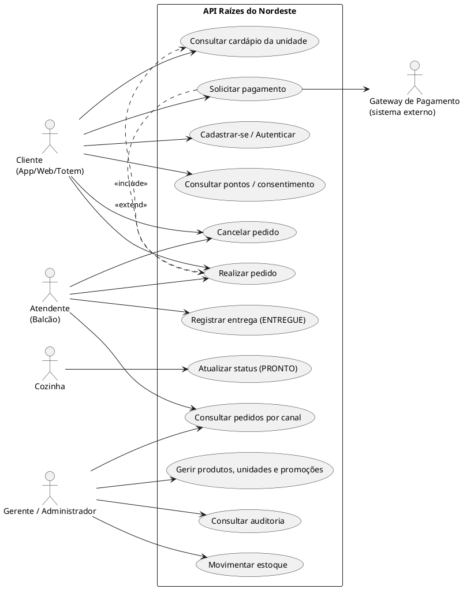
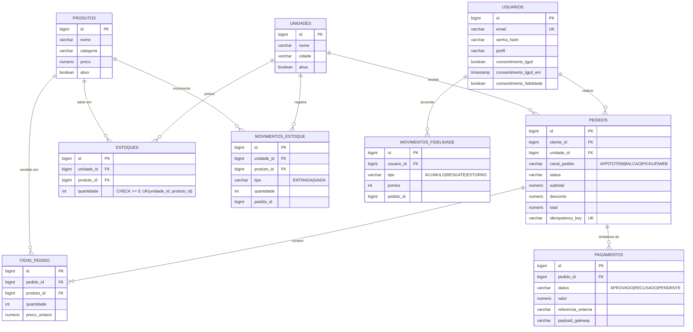
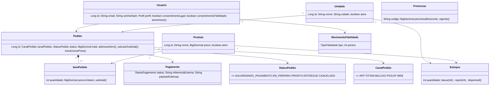
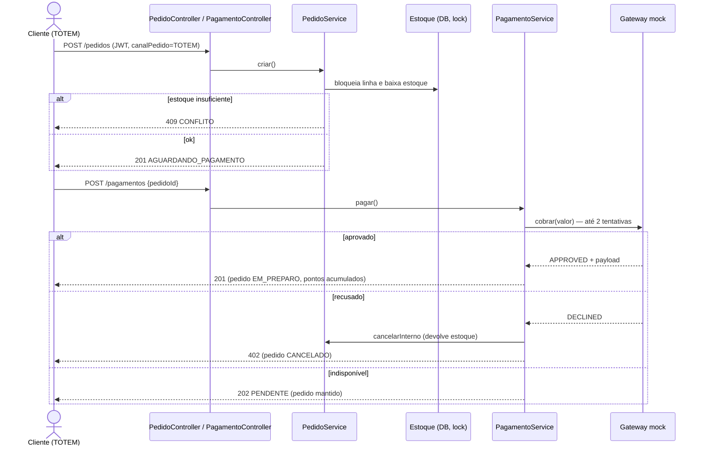

# CAPA

**CENTRO UNIVERSITÁRIO INTERNACIONAL UNINTER**
**TECNOLOGIA EM ANÁLISE E DESENVOLVIMENTO DE SISTEMAS**

**NATÃ SARMENTO DA SILVA** — RU: `<seu RU>`

**PROJETO MULTIDISCIPLINAR — TRILHA BACK-END**
**API REST DA REDE RAÍZES DO NORDESTE: PEDIDOS MULTICANAL, ESTOQUE, PAGAMENTO MOCK E LGPD**

`<Polo/Cidade>` — 2026

> *Formatação ABNT: capa, folha de rosto, sumário, Times/Arial 12, espaçamento 1,5, margens 3/2 cm, citações e referências conforme NBR 14724, 6023 e 10520 (Biblioteca → Normas ABNT no AVA). Cole este texto no Word, aplique o estilo e exporte em PDF.*

# SUMÁRIO
1 Introdução · 2 Análise do problema e requisitos · 3 Diagramas · 4 Arquitetura · 5 API e endpoints · 6 LGPD, privacidade e segurança · 7 Entrega técnica · 8 Plano de testes · 9 Conclusão · Referências

---

# 1 INTRODUÇÃO
A rede **Raízes do Nordeste** opera uma matriz e várias unidades (franquias) que vendem por vários canais (aplicativo, totem, balcão, retirada e web). Este trabalho apresenta o Back-End que sustenta esses canais: uma API REST em Java 17 / Spring Boot 3 com persistência em banco relacional, autenticação JWT por perfil, estoque independente por unidade, pagamento via serviço externo simulado (mock), programa de fidelidade com consentimento e trilha de auditoria.

O **fluxo crítico entregue de ponta a ponta** é o *Fluxo A*: **Pedido → Pagamento mock → Atualização de status**, complementado pelo controle de estoque (Fluxo B) por ser requisito do próprio Fluxo A (o pedido baixa estoque).

# 2 ANÁLISE DO PROBLEMA E REQUISITOS

## 2.1 Contexto
Matriz e unidades compartilham catálogo de produtos, mas cada unidade possui **estoque próprio** e um pedido só pode ser vendido se houver saldo na unidade. O mesmo pedido pode nascer em canais diferentes, e a gerência precisa **consolidar e rastrear pedidos por canal**.

## 2.2 Requisitos funcionais (RF)
| ID | Requisito | Situação |
|---|---|---|
| RF01 | Cadastro e autenticação de usuários com perfis (CLIENTE, ATENDENTE, COZINHA, GERENTE, ADMIN) | Implementado |
| RF02 | Gestão de unidades da rede (listar/criar) | Implementado |
| RF03 | Cardápio por unidade, com disponibilidade vinda do estoque | Implementado |
| RF04 | Produtos (CRUD com desativação lógica) | Implementado |
| RF05 | Pedido com itens, valores, status e **canalPedido obrigatório** (APP, TOTEM, BALCAO, PICKUP, WEB) | Implementado |
| RF06 | Consulta/filtro de pedidos por canal, status e unidade (`?canalPedido=TOTEM`), com paginação | Implementado |
| RF07 | Atualização de status: EM_PREPARO → PRONTO → ENTREGUE / CANCELADO | Implementado |
| RF08 | Controle de estoque por unidade (entrada/saída; bloqueio de venda sem saldo; devolução no cancelamento) | Implementado |
| RF09 | Fidelização: 1 ponto por R$ 1,00 pago; 10 pontos = R$ 1,00 de desconto; **só com consentimento** | Implementado |
| RF10 | Promoções: código percentual aplicado ao subtotal, com vigência | Implementado |
| RF11 | Pagamento via serviço externo (mock): fluxo de envio, retorno (status + payload) e registro | Implementado |
| RF12 | Consulta da trilha de auditoria (ADMIN) | Implementado |
| RF13 | Refresh token / logout | **Proposta** (token de 60 min, sem revogação) |
| RF14 | Estorno de pagamento aprovado em cancelamento posterior | **Proposta** (hoje apenas auditado) |
| RF15 | Estoque/pedidos restritos à unidade do funcionário | **Proposta** (hoje o perfil vale para toda a rede) |

## 2.3 Multicanalidade como requisito de domínio
O campo `canalPedido` (enum `APP, TOTEM, BALCAO, PICKUP, WEB`) é **dado de domínio**: obrigatório na criação (ausente ou inválido → 422 com padrão de erro), persistido no pedido, indexado no banco (`idx_pedidos_canal`) e usado como filtro na listagem. Assim, o mesmo fluxo atende todos os canais e a operação consolida pedidos por canal.

## 2.4 Requisitos não funcionais (RNF)
| ID | Requisito | Como foi tratado |
|---|---|---|
| RNF01 | Segurança | Senhas com BCrypt; JWT assinado (HS256) com expiração; autorização por perfil via `@PreAuthorize`; respostas nunca expõem hash |
| RNF02 | LGPD | Consentimento registrado com data; minimização; anonimização; ver seção 6 |
| RNF03 | Auditoria | Tabela `auditoria` + log `AUDITORIA` para ações sensíveis (pedido, status, pagamento, estoque, login) |
| RNF04 | Desempenho em pico | API *stateless* (escala horizontal), paginação obrigatória nas listagens (limit ≤ 100), índices por canal/status/unidade, bloqueio pessimista restrito à linha de estoque; **cache e fila ficaram como proposta** |
| RNF05 | Disponibilidade | Stateless + banco externo configurável por variável de ambiente (PostgreSQL em produção); **health check/réplicas como proposta** |
| RNF06 | Tolerância a falhas no pagamento | Gateway atrás de uma *porta* (`PagamentoGateway`); 2 tentativas; se indisponível, registra pagamento PENDENTE, mantém o pedido em AGUARDANDO_PAGAMENTO e responde 202 |
| RNF07 | Documentação | OpenAPI/Swagger gerado pelo código (springdoc) + este relatório |
| RNF08 | Idempotência | Header `Idempotency-Key` em `POST /pedidos` (chave única no banco) e regra por estado no pagamento |

## 2.5 Priorização do MVP (implementado × planejado)
**Prioridade 1 (entregue):** autenticação + perfis, pedido com `canalPedido`, estoque por unidade, pagamento mock (aprovado/recusado/indisponível), status do pedido, padrão de erro, LGPD mínimo, auditoria, plano de testes executável. *Justificativa:* é o menor conjunto que fecha o fluxo A com persistência real e é exatamente o que a avaliação exige.
**Prioridade 2 (entregue):** fidelidade, promoções, anonimização.
**Prioridade 3 (proposta):** refresh/logout, estorno, escopo por unidade, cache, observabilidade, deploy.

# 3 DIAGRAMAS

## 3.1 Diagrama de casos de uso
Atores: **Cliente** (App/Web/Totem), **Atendente** (Balcão), **Cozinha**, **Gerente/Administrador** e **Gateway de Pagamento** (sistema externo). Renderize em https://www.plantuml.com/plantuml e insira a imagem.



## 3.2 Descrição de feature: Realizar Pedido + Solicitar Pagamento
| Item | Descrição |
|---|---|
| **Atores** | Cliente (ou Atendente em nome do cliente); Gateway de pagamento (mock) |
| **Pré-condições** | Usuário autenticado (JWT); unidade ativa; produtos ativos com estoque na unidade |
| **Fluxo principal** | 1) Ator envia `POST /pedidos` com `canalPedido`, unidade, itens, `formaPagamento=MOCK`, promoção/pontos opcionais. 2) API valida dados e permissões. 3) Para cada item, bloqueia a linha de estoque, confere saldo e baixa. 4) Calcula subtotal, descontos e total. 5) Persiste o pedido (AGUARDANDO_PAGAMENTO) e os movimentos de estoque. 6) Ator envia `POST /pagamentos`. 7) API chama o gateway mock, registra o pagamento (referência + payload). 8) Aprovado: pedido → EM_PREPARO e pontos são acumulados (se houver consentimento). |
| **Pós-condições** | Pedido persistido com canal e status coerentes; estoque baixado; pagamento registrado; auditoria gravada |
| **Exceções** | Canal ausente/inválido (422); produto/unidade inexistente ou produto não vendido na unidade (404); **estoque insuficiente (409)**; promoção inválida (422); saldo de pontos insuficiente (409); **pagamento recusado (402)**: pedido CANCELADO, estoque devolvido, pontos estornados; **gateway indisponível (202)**: pagamento PENDENTE, pedido mantido; pedido fora de AGUARDANDO_PAGAMENTO (409) |
| **Regras de negócio** | Preço do item é "congelado" no pedido; estoque nunca fica negativo (CHECK no banco + regra no domínio); **idempotência** por `Idempotency-Key`; 10 pontos = R$ 1,00; desconto não pode exceder o subtotal; resgate exige consentimento |

## 3.3 DER (modelo de dados)
O DER é compatível com `V1__schema.sql` (Flyway). Renderize em https://mermaid.live.


Tabelas sem relacionamento forte, por desenho: `promocoes` (aplicada por código no pedido) e `auditoria` (registro imutável, sem FK para sobreviver à anonimização/remoção). **Pagamento é desacoplado:** só referencia o pedido por FK e guarda a resposta do gateway; um pedido pode ter várias tentativas.

## 3.4 Diagrama de classes (domínio)


## 3.5 Diagrama de sequência — Pedido → Pagamento externo → Status


# 4 ARQUITETURA
Arquitetura em camadas com dependências apontando para o domínio:

| Camada | Pacote | Responsabilidade | Exemplos |
|---|---|---|---|
| **Domain** | `domain` | Entidades, regras e comportamentos | `Pedido.transicionarPara`, `Estoque.baixar`, `StatusPedido.podeIrPara`, exceções de negócio |
| **Application** | `application` | Casos de uso que orquestram o fluxo; portas | `PedidoService.criar`, `PagamentoService.pagar`, `FidelidadeService`, `PagamentoGateway` (porta) |
| **Infrastructure** | `infrastructure` | Persistência, integrações e detalhes técnicos | Repositórios Spring Data/JPA, Flyway, `PagamentoMockGateway`, `JwtService`, `SecurityConfig`, `DataSeeder` |
| **API** | `api` | Controllers, contratos e erros | `PedidoController`, `Dtos`, `GlobalExceptionHandler`, Swagger |

**Decisões:** (i) o gateway é uma *porta* — trocar o mock por um provedor real não altera a aplicação (inversão de dependência); (ii) as regras (estado do pedido, estoque) ficam nas entidades, não nos controllers; (iii) por pragmatismo, as entidades JPA são as do domínio (DDD simplificado) e os serviços retornam DTOs dentro da transação para evitar *lazy loading* fora dela.

# 5 API E ENDPOINTS
**Convenções:** URLs no plural; IDs no path; paginação `?page=1&limit=10` (resposta `{conteudo,page,limit,totalElementos,totalPaginas}`); autenticação `Authorization: Bearer <JWT>`; status coerentes (200/201/204/400/401/402/403/404/409/422); **erro padronizado** em todas as falhas:
```json
{ "timestamp": "2026-10-10T15:30:00", "status": 422, "codigo": "VALIDACAO",
  "mensagem": "Dados inválidos", "path": "/pedidos",
  "detalhes": ["canalPedido: não deve ser nulo"] }
```

## 5.1 Resumo dos endpoints
| Propósito | Método e rota | Permissão | Parâmetros | Status |
|---|---|---|---|---|
| Cadastrar cliente (consentimento LGPD) | POST `/auth/register` | Público | body | 201, 409, 422 |
| Login | POST `/auth/login` | Público | body | 200, 401, 422 |
| Criar funcionário | POST `/usuarios` | ADMIN | body | 201, 403, 409, 422 |
| Meus dados (auditado) | GET `/usuarios/me` | Autenticado | — | 200, 401 |
| Anonimizar minha conta (LGPD) | DELETE `/usuarios/me` | Autenticado | — | 204, 401 |
| Listar unidades | GET `/unidades` | Público | page, limit | 200 |
| Cardápio da unidade | GET `/unidades/{id}/cardapio` | Público | id, page, limit | 200, 404 |
| Criar unidade | POST `/unidades` | ADMIN | body | 201, 403, 422 |
| Listar/consultar produtos | GET `/produtos`, `/produtos/{id}` | Autenticado | page, limit, id | 200, 404 |
| Criar/atualizar/desativar produto | POST, PUT, DELETE `/produtos[/{id}]` | GERENTE, ADMIN | body, id | 201/200/204, 403, 404, 422 |
| Movimentar estoque | POST `/estoque/movimentos` | GERENTE, ADMIN | body | 201, 403, 404, 409, 422 |
| Consultar estoque | GET `/estoque` | ATENDENTE, COZINHA, GERENTE, ADMIN | unidadeId, page, limit | 200, 403, 404 |
| **Criar pedido** | POST `/pedidos` | CLIENTE, ATENDENTE, GERENTE, ADMIN | body; header `Idempotency-Key` | 201, 403, 404, 409, 422 |
| **Listar pedidos / filtrar canal** | GET `/pedidos` | Autenticado (cliente vê só os seus) | canalPedido, status, unidadeId, page, limit | 200, 400, 401 |
| Consultar pedido | GET `/pedidos/{id}` | Autenticado (dono) | id | 200, 403, 404 |
| **Atualizar status** | PATCH `/pedidos/{id}/status` | COZINHA (só PRONTO), ATENDENTE, GERENTE, ADMIN | id, body | 200, 403, 404, 409 |
| Cancelar pedido | POST `/pedidos/{id}/cancelar` | CLIENTE (dono), ATENDENTE, GERENTE, ADMIN | id | 200, 403, 404, 409 |
| **Solicitar pagamento (mock)** | POST `/pagamentos` | CLIENTE, ATENDENTE, GERENTE, ADMIN | body | 201, 202, 402, 403, 404, 409 |
| Tentativas de pagamento | GET `/pagamentos` | Autenticado (dono) | pedidoId | 200, 403, 404 |
| Saldo / histórico de pontos | GET `/fidelidade/saldo`, `/fidelidade/historico` | CLIENTE | page, limit | 200, 403 |
| Consentimento de fidelidade | PUT `/fidelidade/consentimento` | CLIENTE | body | 200, 403, 422 |
| Promoções | GET, POST `/promocoes` | Autenticado / GERENTE, ADMIN | page, limit, body | 200/201, 403, 409, 422 |
| Auditoria | GET `/auditoria` | ADMIN | acao, page, limit | 200, 403 |

## 5.2 Contratos detalhados dos endpoints críticos
**POST /auth/login** — público
```json
// request
{ "email": "cliente@raizes.com", "senha": "Cliente@123" }
// 200
{ "accessToken": "eyJhbGciOi...", "tokenType": "Bearer", "expiresInSeconds": 3600 }
```
Erros: 401 `NAO_AUTENTICADO` (credenciais inválidas); 422 `VALIDACAO`.

**POST /pedidos** — JWT (CLIENTE/ATENDENTE/GERENTE/ADMIN); header opcional `Idempotency-Key`. *Extensão ao exemplo mínimo do roteiro: `unidadeId` é obrigatório, pois o estoque é por unidade.*
```json
// request
{ "canalPedido": "TOTEM", "unidadeId": 1,
  "itens": [ { "produtoId": 1, "quantidade": 2 } ],
  "formaPagamento": "MOCK", "codigoPromocao": "BEMVINDO10", "resgatarPontos": 0 }
// 201
{ "id": 7, "clienteId": 5, "unidadeId": 1, "canalPedido": "TOTEM", "status": "AGUARDANDO_PAGAMENTO",
  "formaPagamento": "MOCK", "subtotal": 57.80, "desconto": 5.78, "total": 52.02,
  "codigoPromocao": "BEMVINDO10", "pontosResgatados": 0,
  "itens": [ { "produtoId": 1, "produto": "Baião de Dois", "quantidade": 2, "precoUnitario": 28.90, "subtotal": 57.80 } ] }
```
Erros: 422 (canal ausente/inválido, quantidade < 1, promoção inválida), 404 (produto/unidade inexistente ou não vendido na unidade), 409 (estoque insuficiente, saldo de pontos insuficiente).

**GET /pedidos?canalPedido=APP&status=AGUARDANDO_PAGAMENTO&page=1&limit=10** → 200 com página de `PedidoResponse`; `canalPedido` ou `status` inválido → 400 `PARAMETRO_INVALIDO`.

**POST /pagamentos** — JWT
```json
// request (simularResultado é opcional e só serve para testar o mock)
{ "pedidoId": 7, "simularResultado": "APROVADO" }
// 201
{ "id": 3, "pedidoId": 7, "status": "APROVADO", "valor": 52.02, "referenciaExterna": "MOCK-6f1c...",
  "mensagem": "Pagamento aprovado (mock)",
  "payloadGateway": "{\"transactionId\":\"MOCK-6f1c...\",\"orderId\":7,\"amount\":52.02,\"status\":\"APPROVED\",\"reason\":null}",
  "statusPedido": "EM_PREPARO" }
```
`RECUSADO` → **402** com `status: RECUSADO`, `statusPedido: CANCELADO`. `TIMEOUT` → **202** com `status: PENDENTE`, `statusPedido: AGUARDANDO_PAGAMENTO`.

**PATCH /pedidos/{id}/status**
```json
{ "status": "PRONTO" }
```
200 com o pedido atualizado; 409 em transição inválida (ex.: ENTREGUE → PRONTO); 403 se COZINHA tentar outro status.

**POST /estoque/movimentos** (GERENTE/ADMIN)
```json
{ "unidadeId": 1, "produtoId": 1, "tipo": "ENTRADA", "quantidade": 10, "motivo": "Reposição semanal" }
```
201 com `{unidadeId, produtoId, produto, quantidade}`; SAIDA acima do saldo → 409.

> Os demais endpoints seguem o mesmo padrão e estão documentados com exemplos no Swagger (`/swagger-ui.html`), gerado a partir do código.

# 6 LGPD, PRIVACIDADE E SEGURANÇA

## 6.1 Dados pessoais, finalidade e base legal (Lei 13.709/2018)
| Dado | Finalidade | Base legal | Minimização / proteção |
|---|---|---|---|
| Nome e e-mail | Identificar o cliente e autenticar | Execução de contrato (art. 7º, V) | Somente o necessário; sem CPF, endereço ou cartão |
| Senha | Autenticação | Execução de contrato | **Hash BCrypt**; nunca retorna em respostas nem em logs |
| Consentimento LGPD (booleano + data/hora) | Comprovar o aceite no cadastro | Consentimento (art. 7º, I) | Cadastro é recusado sem o aceite (422) |
| Consentimento de fidelidade | Acumular/resgatar pontos | Consentimento (art. 7º, I) | Opcional, **revogável** (`PUT /fidelidade/consentimento`); sem consentimento não há acúmulo nem resgate |
| Histórico de pedidos/pagamentos | Operação, suporte e fiscal | Execução de contrato / obrigação legal | Pagamento guarda só referência e payload do mock |
| Auditoria (e-mail do operador, ação, entidade) | Segurança e rastreabilidade (art. 46) | Legítimo interesse / segurança | Não registra senha, token nem payload sensível |

## 6.2 Controles implementados
- **Hash de senha** (BCrypt) e **token JWT** assinado com expiração; 401 para token ausente/inválido, 403 para perfil sem permissão.
- **Autorização por perfil** nos endpoints e **por propriedade** (cliente só vê/cancela/paga os próprios pedidos).
- **Logs de acesso a dado pessoal:** `GET /usuarios/me` gera `ACESSO_DADOS_PESSOAIS`; login (sucesso/falha), criação de pedido, mudança de status, cancelamento, pagamento, movimentação de estoque e mudanças de consentimento geram registros em `auditoria`.
- **Direito de eliminação/anonimização:** `DELETE /usuarios/me` substitui nome e e-mail, desativa a conta e revoga a fidelidade, preservando os pedidos (integridade fiscal/operacional).
- **Estratégia de retenção (proposta):** rotina periódica que anonimiza contas inativas por prazo definido pela empresa (ex.: 5 anos) — *não implementada*.
- **Segredos por variável de ambiente** (`JWT_SECRET`, banco); nada sensível versionado (`.env` no `.gitignore`).

# 7 ENTREGA TÉCNICA
| Entregável | Local |
|---|---|
| Repositório Git público (código em camadas, ≥ 5 commits) | `<link do repositório>` |
| README de execução | `README.md` |
| Swagger/OpenAPI | `http://localhost:8080/swagger-ui.html` · `/v3/api-docs` |
| Coleção Postman (38 requisições, pastas por recurso, asserts) | `postman/raizes-do-nordeste.postman_collection.json` |
| DER (imagem/PDF) | Seção 3.3 (gerar imagem do bloco Mermaid) e `db/migration/V1__schema.sql` |
| Link de deploy (opcional) | Não possui |

**MVP:** Fluxo A completo com persistência real em banco (JPA + Flyway), JWT com 5 perfis e padrão de erro único. **Sugestão de commits:** (1) estrutura + migrations; (2) domínio; (3) auth/JWT; (4) estoque e catálogo; (5) pedidos; (6) pagamento mock + fidelidade; (7) auditoria/LGPD; (8) Postman + README.

# 8 PLANO DE TESTES
Todos os cenários estão **executáveis** na coleção Postman (nome da requisição = evidência). Pré-condição geral: API no ar com banco limpo (seed aplicado) e execução na ordem das pastas.

| ID | Cenário | Endpoint | Pré-condição | Entrada | Esperado | Evidência (Postman) |
|---|---|---|---|---|---|---|
| T01 | Login válido | POST /auth/login | seed | cliente@raizes.com / Cliente@123 | 200 + `accessToken` | Auth / T01 |
| T02 | Listar unidades | GET /unidades | seed | page=1&limit=10 | 200, ≥ 2 unidades | Unidades e Cardápio / T02 |
| T03 | Cardápio | GET /unidades/1/cardapio | seed | — | 200, itens com `disponivel` | T03 |
| T04 | Criar pedido TOTEM com promoção | POST /pedidos | cliente logado | canal TOTEM, produto 1 x2, BEMVINDO10 | 201, AGUARDANDO_PAGAMENTO, total 52.02 | Pedidos / T04 |
| T05 | Pagamento aprovado | POST /pagamentos | T04 | simularResultado APROVADO | 201, `statusPedido` EM_PREPARO | T05 |
| T06 | Cozinha → PRONTO | PATCH /pedidos/{id}/status | T05 | PRONTO | 200, status PRONTO | T06 |
| T07 | Atendente → ENTREGUE | PATCH /pedidos/{id}/status | T06 | ENTREGUE | 200, ENTREGUE | T07 |
| T08 | Filtro por canal | GET /pedidos?canalPedido=TOTEM | atendente | — | 200, todos TOTEM | T08 |
| T09 | Pontos acumulados | GET /fidelidade/saldo | T05 + consentimento | — | 200, pontos > 0 | Fidelidade / T09 |
| T10 | Entrada de estoque | POST /estoque/movimentos | gerente | ENTRADA 10 | 201 | Estoque / T10 |
| T11 | Auditoria do pedido | GET /auditoria?acao=PEDIDO_CRIADO | admin | — | 200, registros > 0 | Auditoria / T11 |
| T12 | Sem token | GET /pedidos | — | — | 401 + erro padrão | Erros / T12 |
| T13 | Perfil sem permissão | POST /estoque/movimentos | cliente logado | ENTRADA | 403 + erro padrão | T13 |
| T14 | Canal ausente | POST /pedidos | cliente | sem `canalPedido` | 422 + erro padrão | T14 |
| T15 | Canal inválido | POST /pedidos | cliente | `TELEFONE` | 422 + valores aceitos | T15 |
| T16 | Produto inexistente | POST /pedidos | cliente | produtoId 9999 | 404 | T16 |
| T17 | Estoque insuficiente | POST /pedidos | cliente | quantidade 9999 | 409 | T17 |
| T18 | Pagamento recusado | POST /pagamentos | pedido B criado | RECUSADO | 402, pedido CANCELADO | Pagamento mock - falhas / T18 |
| T19 | Quantidade negativa | POST /pedidos | cliente | quantidade -1 | 422 | T19 |
| T20 | Filtro de canal inválido | GET /pedidos?canalPedido=XYZ | atendente | — | 400 | T20 |
| T21 | Produto não vendido na unidade | POST /pedidos | seed | produto 5, unidade 2 | 404 | T21 |
| T22 | Gateway indisponível | POST /pagamentos | pedido C | TIMEOUT | 202, PENDENTE, pedido mantido | T22 |
| T23 | Pagar pedido cancelado | POST /pagamentos | T18 | pedido B | 409 | T23 |
| T24 | Senha errada | POST /auth/login | seed | senha incorreta | 401 | Auth / T24 |

**Totais:** 24 cenários (14 positivos/estado esperado e 10 negativos), cobrindo autenticação/autorização, validação, regras do fluxo, pagamento mock aprovado/recusado/indisponível e auditoria. Há ainda 3 testes unitários de domínio (`RegrasDominioTest`: estoque, transições de status e subtotal).

> **Evidências a anexar:** prints do *Collection Runner* com todos os asserts aprovados e do Swagger com um exemplo.

# 9 CONCLUSÃO
**Implementado:** API executável com persistência (JPA + Flyway), autenticação JWT com cinco perfis, cadastro com consentimento, unidades, cardápio por unidade, estoque com bloqueio e histórico de movimentos, pedidos multicanal com `canalPedido` obrigatório e filtro, pagamento mock com três desfechos, fidelidade, promoções, auditoria e anonimização. **Proposta:** refresh/logout, estorno de pagamento aprovado, escopo por unidade, retenção automática, cache, observabilidade e deploy — priorizados abaixo do fluxo principal porque a avaliação e o negócio dependem primeiro de um fluxo fechado, seguro e testável.

**Conexão entre artefatos:** os casos de uso *Realizar pedido* e *Solicitar pagamento* correspondem a `POST /pedidos` e `POST /pagamentos`; as entidades do diagrama de classes são as do DER (`Pedido`, `ItemPedido`, `Estoque`, `Pagamento`), e as regras de estado (`StatusPedido`) governam o `PATCH /pedidos/{id}/status`, exatamente como na sequência.

**Pagamento mock:** isolado pela porta `PagamentoGateway`, devolve referência e payload JSON; aprovado → EM_PREPARO; recusado → 402 + cancelamento com devolução de estoque; indisponível → 202 com pedido mantido. **Padronização:** um único JSON de erro (`timestamp, status, codigo, mensagem, path, detalhes`) e códigos coerentes (400/401/402/403/404/409/422). **Segurança/LGPD:** BCrypt, JWT, perfis, consentimento, minimização, auditoria e anonimização. **Testes:** a coleção executa os 24 cenários e comprova o funcionamento do fluxo.

*Se apresentado em uma entrevista técnica, o projeto se sustenta por ter fluxo fechado, regras no domínio, segurança aplicada e evidências reproduzíveis; os limites (item 2.2) foram declarados com transparência.*

# REFERÊNCIAS
BRASIL. **Lei nº 13.709, de 14 de agosto de 2018.** Lei Geral de Proteção de Dados Pessoais (LGPD). Brasília, DF: Presidência da República, 2018.

FIELDING, Roy T. **Architectural styles and the design of network-based software architectures.** 2000. Tese (Doutorado em Ciência da Computação) — University of California, Irvine, 2000.

INTERNET ENGINEERING TASK FORCE. **RFC 7519: JSON Web Token (JWT).** 2015.

OPENAPI INITIATIVE. **OpenAPI Specification v3.1.0.** Disponível em: https://spec.openapis.org. Acesso em: 10 out. 2026.

SPRING. **Spring Boot Reference Documentation.** Disponível em: https://docs.spring.io/spring-boot. Acesso em: 10 out. 2026.

ASSOCIAÇÃO BRASILEIRA DE NORMAS TÉCNICAS. **NBR 14724:** informação e documentação — trabalhos acadêmicos — apresentação. Rio de Janeiro: ABNT, 2024.
